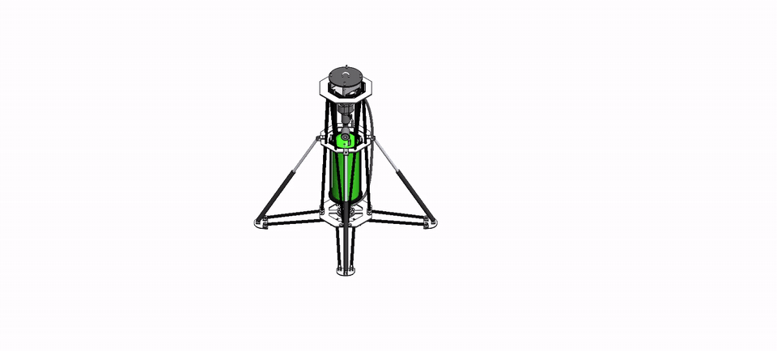
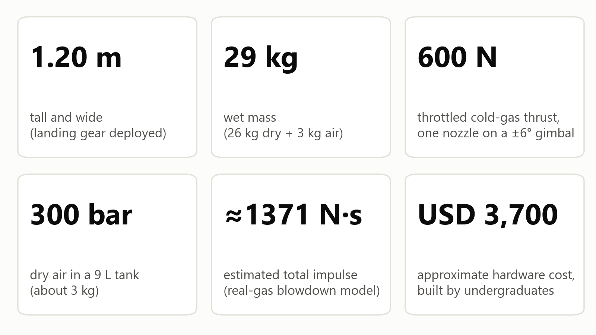
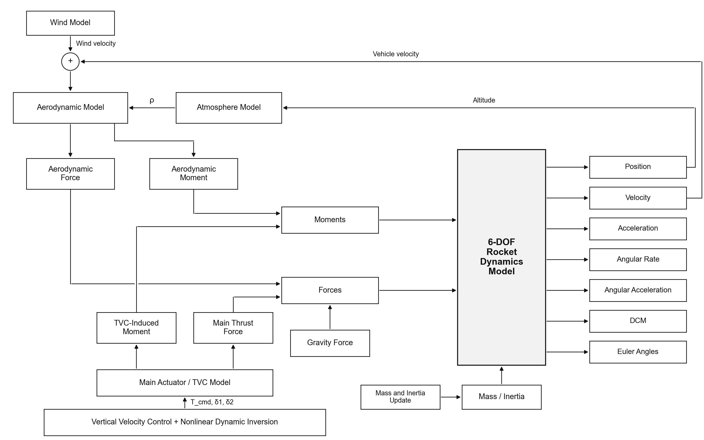
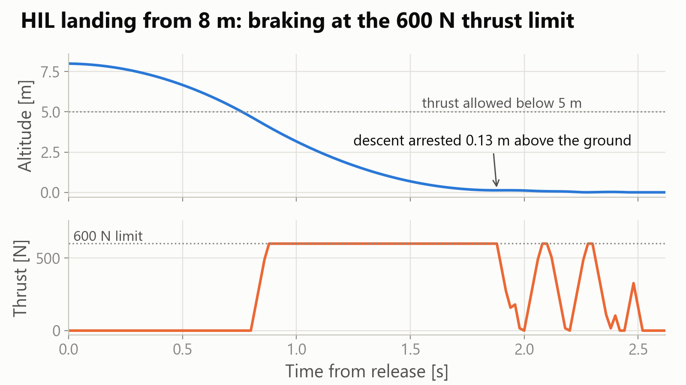
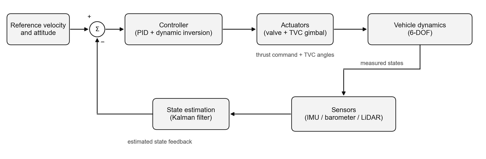
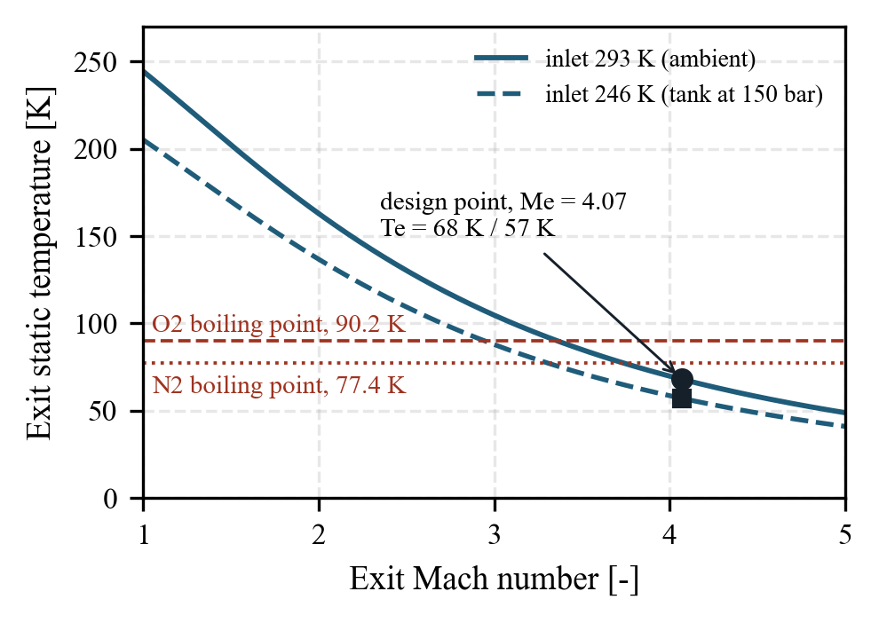
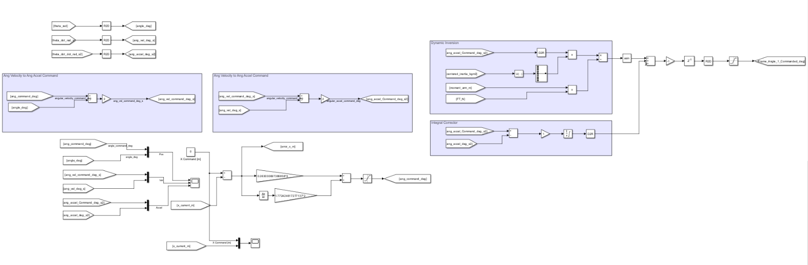
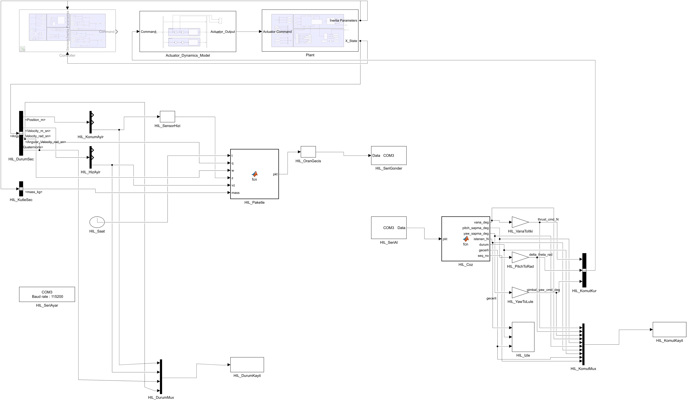
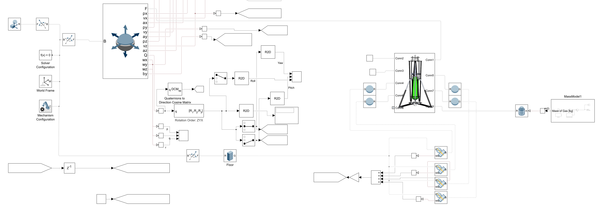

# Cold-Gas Vertical Landing Rocket

Design, 6-DOF simulation, nonlinear control, hardware-in-the-loop testing and field testing of a low-cost cold-gas vertical landing rocket with thrust vector control, built by an undergraduate team at Erciyes University for the TEKNOFEST Vertical Landing Rocket Competition (2026).

The work was presented at the **77th International Astronautical Congress (IAC 2026, Antalya)** as paper **IAC-26-E2.IPB.14.x114159**:
- Paper: [IAF Digital Library](https://dl.iafastro.directory/event/IAC-2026/paper/114159/)
- Interactive poster: [iPoster](https://iac2026.ipostersessions.com/default.aspx?s=E7-0E-84-82-39-DD-8D-5E-26-E3-B7-00-3D-CD-E6-11&guestview=true)
- Equations, design values and results: **[Technical Summary](docs/TECHNICAL_SUMMARY.md)**

<p align="center">
  
</p>

## The vehicle



| | |
|---|---|
| Height × width (gear deployed) | 1.20 m × 1.20 m |
| Mass | 25.9 kg dry, 29.0 kg wet |
| Propellant | Dry air, 9 L tank at 300 bar |
| Propulsion | Motorised needle valve, one convergent-divergent nozzle (600 N at 150 bar, Mach 4.07) |
| Attitude control | Thrust vector control, ±6° two-axis gimbal |
| Avionics | ESP32-S3, BNO055 IMU, BMP390 barometer, TFmini Plus LiDAR |
| Hardware cost | ≈ USD 3,700 |

## Highlights

- **Real-gas propulsion design.** The Peng–Robinson blowdown model and a 1-D nozzle design checked against 3-D CFD (agreement within 0.4 %) give an estimated total impulse of ≈ 1371 N·s and show that stored impulse, not thrust, sizes the mission.
- **6-DOF flight simulation.** Built in Simulink and Simscape Multibody, with variable gas mass, atmosphere, gust and per-leg ground contact.
- **Nonlinear dynamic inversion attitude control.** Uses live thrust, inertia and moment arm, so the loop gain adapts through the burn; gain margins of 8.9–11.4 dB and phase margins of 46.5–58.2°.
- **Hardware-in-the-loop.** The real flight computer, TVC servos and valve drive ran in a 50 Hz lock-step loop with the simulated vehicle. The campaign caught five integration issues before flight and established a 120 ms latency bound (measured 20–27 ms). The 25 s hover held thrust within 0.1 % of equilibrium.
- **Ground tests.** 180 bar held for one hour, five successful nozzle firings and two structural drop tests passed; field drop tests and the competition flight produced onboard flight data.





| Control loop (PID + dynamic inversion) | Nozzle exit temperature |
|---|---|
|  |  |



### Hardware-in-the-loop model (Simulink)

The HIL loop exchanges state and command packets with the ESP32-S3 flight computer over a serial link at 50 Hz, while the vehicle dynamics run in Simulink/Simscape:





## Repository layout

```
simulation/
  ndi_6dof/        6-DOF Simulink/Simscape model with nonlinear dynamic inversion (NDI)
  ktr_6dof/        6-DOF flight simulation from the critical design review
  hil_plant/       Vehicle model and loop architecture for hardware-in-the-loop testing
hil/               MATLAB HIL runner and plotting scripts, run summaries and plots (landing, hover)
firmware/          ESP32-S3 flight software with HIL mode (landing and hover builds, earlier v30)
data/
  flight/          Onboard flight logs from the field campaign
  hil/             HIL landing and hover runs
  propulsion/      Real-gas blowdown thrust-time tables (300/400/600 N)
  bom/             Bill of materials with supplier links
analysis/          Python scripts that produce the figures from the data
figures/
  paper/           Paper figures
  simulation_model/ Simulink/Simscape subsystems of the flight simulation
  simulink_models/ Diagrams exported from the Simulink models
  simulink/        Simulation result plots and Simulink screenshots
  hardware/        Vehicle photos, avionics board and CAD renders
poster/            iPoster graphics, short test clips and the scripts that made them
docs/              Technical summary and architecture diagram
```

## Running

Python 3.10+ with `numpy`, `matplotlib` and `openpyxl`:

```bash
cd analysis
python sekil_uret.py            # thrust, impulse and nozzle figures
python itki_gecikme_butcesi.py  # thrust-onset budget
cd ../poster/scripts
python uret_grafikler.py        # poster graphics
```

The Simulink models need MATLAB/Simulink with Simscape Multibody (R2024a or later). The firmware targets the ESP32-S3 with the Arduino core; set `SLAVE_MAC` to your own ground-station address before building. Most code comments and some file names are in Turkish.

The paper itself (copyright © IAF), the competition design reports, the CAD source files and the raw test videos are not included.

## Team

S-TEK Vertical Landing Rocket Team, Erciyes University: Hasan Baran Gurbuz, Osman Melih Eroglu, Ayse Sila Dogan, Berkay Polat, Baris Feytek, Sami Pekdemir, Serhat Seren, Arda Kaan Ergul, Murat Atici, Asya Demir.

Supported by TÜBİTAK SAGE, TEKNOFEST and Erciyes University.

## Citation

```
H.B. Gurbuz et al., Low-Cost Prototyping of Reusable Launch Systems: Design and Flight Testing of a
Cold-Gas Vertical Landing Rocket, 77th International Astronautical Congress (IAC 2026), Antalya,
Türkiye, 5–9 October 2026, IAC-26-E2.IPB.14.x114159.
```

## License

© 2026 the authors. All rights reserved. Please get in touch before reusing the code, data or media.
