# Cold-Gas Vertical Landing Rocket

Design, 6-DOF simulation, nonlinear control, hardware-in-the-loop testing and field testing of a low-cost cold-gas vertical landing rocket with thrust vector control, built by an undergraduate team at Erciyes University for the TEKNOFEST Vertical Landing Rocket Competition (2026).

The work was presented at the **77th International Astronautical Congress (IAC 2026, Antalya)** as paper **IAC-26-E2.IPB.14.x114159**:
- Paper: [IAF Digital Library](https://dl.iafastro.directory/event/IAC-2026/paper/114159/)
- Interactive poster: [iPoster](https://iac2026.ipostersessions.com/default.aspx?s=E7-0E-84-82-39-DD-8D-5E-26-E3-B7-00-3D-CD-E6-11&guestview=true)

<p align="center">
  
</p>

## Highlights

- **Real-gas propulsion design.** The Peng–Robinson blowdown model and a 1-D nozzle design checked against 3-D CFD (agreement within 0.4 %) give an estimated total impulse of ≈ 1371 N·s and show that stored impulse, not thrust, sizes the mission.
- **6-DOF flight simulation.** Built in Simulink and Simscape Multibody, with variable gas mass, atmosphere, gust and per-leg ground contact.
- **Nonlinear dynamic inversion attitude control.** Uses live thrust, inertia and moment arm, so the loop gain adapts through the burn; gain margins of 8.9–11.4 dB and phase margins of 46.5–58.2°.
- **Hardware-in-the-loop.** The real flight computer, TVC servos and valve drive ran in a 50 Hz lock-step loop with the simulated vehicle. The campaign caught five integration issues before flight and established a 120 ms latency bound (measured 20–27 ms). The 25 s hover held thrust within 0.1 % of equilibrium.
- **Ground tests.** 180 bar held for one hour, five successful nozzle firings and two structural drop tests passed; field drop tests and the competition flight produced onboard flight data.

**Contents**

1. [Vehicle](#1-vehicle)
2. [Cold-gas propulsion](#2-cold-gas-propulsion)
3. [Flight dynamics model](#3-flight-dynamics-model)
4. [Guidance and control](#4-guidance-and-control)
5. [Navigation and sensor fusion](#5-navigation-and-sensor-fusion)
6. [Discretisation and stability](#6-discretisation-and-stability)
7. [Simulation results](#7-simulation-results)
8. [Hardware-in-the-loop testing](#8-hardware-in-the-loop-testing)
9. [Ground and field tests](#9-ground-and-field-tests)
10. [Simulink model gallery](#10-simulink-model-gallery)

---

## 1. Vehicle


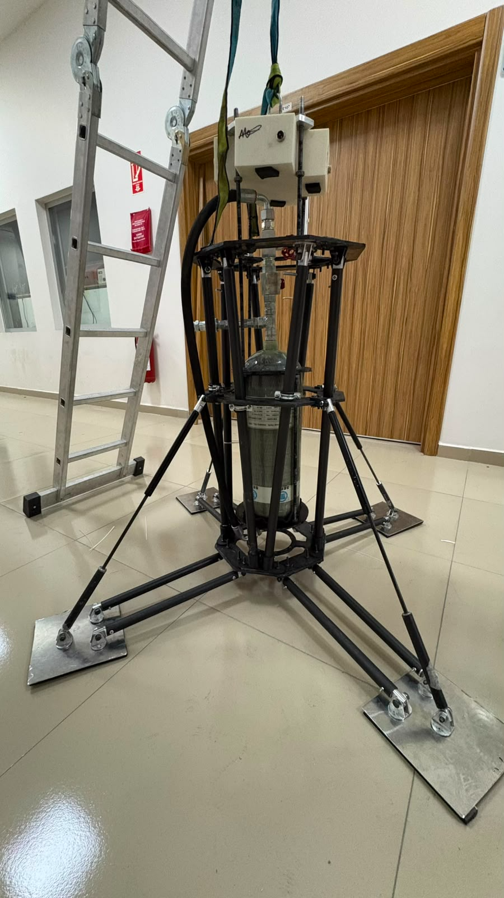

| Property | Value |
|---|---|
| Height / width (gear deployed) | 1.20 m / 1.20 m |
| Dry / gas / wet mass | 25.94 kg / 3.04 kg / 28.98 kg |
| Inertia I<sub>xx</sub>, I<sub>yy</sub>, I<sub>zz</sub> | 1.913, 1.995, 0.845 kg m² |
| Structure | Open truss of eight carbon-fibre tubes between octagonal carbon-fibre bulkheads |
| Landing gear | Four articulated legs with pneumatic dampers and compliant feet |
| Avionics | BORTE-I board: ESP32-S3, BNO055 IMU, BMP390 barometer, TFmini Plus LiDAR, microSD, ESP-NOW telemetry |
| Hardware cost | ≈ USD 3,700 (structure 49 %, propulsion 25 %, avionics 26 %) |

The open truss gives direct access to the pneumatic hardware between flights, and the 9 L tank sits on the longitudinal axis to keep lateral inertia low. Static FEA of the bulkheads, tubes and leg struts under 500 N and 800 N load cases gives peak von Mises stresses of 150–160 MPa, a margin of at least 1.5 on the lower-bound composite strengths.

| Exploded view | BORTE-I avionics board |
|---|---|
| 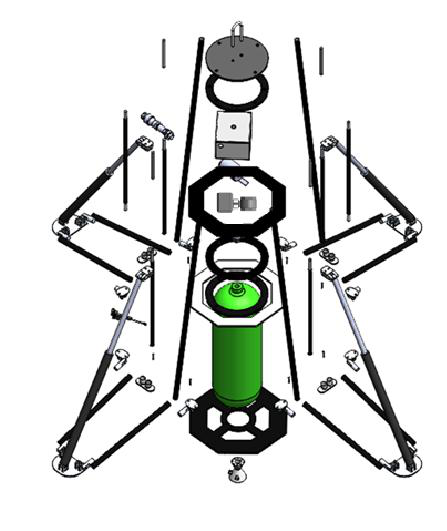 | 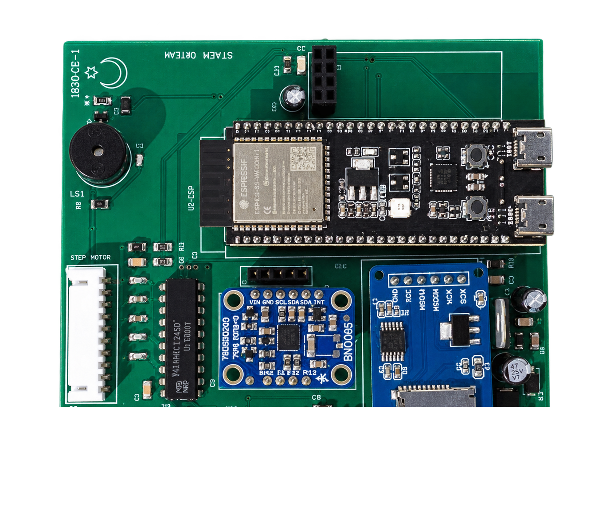 |

---

## 2. Cold-gas propulsion

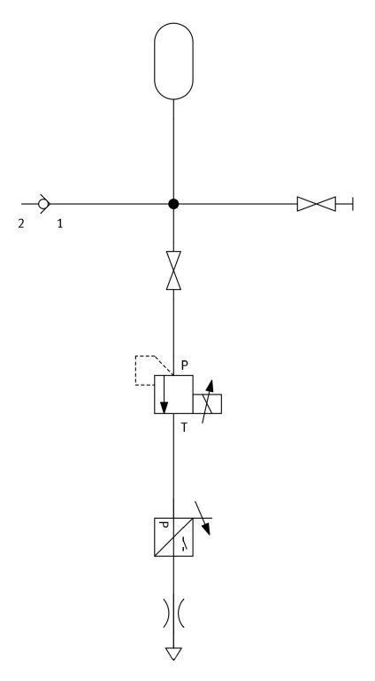

Dry air at 300 bar flows from a 9 L tank through a quarter-turn motorised ball valve and a stepper-driven needle valve (NEMA 34 with planetary reducer, closed-loop encoder drive) to a single convergent-divergent nozzle on a two-axis gimbal.

### Nozzle design

The nozzle is sized for 600 N at a 150 bar inlet with full expansion to ambient:

$$F = \dot m\, v_e + (P_e - P_a)\,A_e$$

$$\dot m = \frac{A^{*} P_t\, \Gamma}{\sqrt{R\,T_t}}, \qquad \Gamma = \sqrt{\gamma}\left(\frac{2}{\gamma+1}\right)^{\frac{\gamma+1}{2(\gamma-1)}}$$

$$T_e = \frac{T_t}{1 + \frac{\gamma-1}{2} M_e^2}$$

| Parameter | 1-D design | 3-D CFD (Ansys CFX, SST) |
|---|---|---|
| Inlet total pressure / temperature | 150 bar / 293.15 K | boundary condition |
| Throat / exit diameter | 5.66 / 19.13 mm | 5.66 / 19.12 mm |
| Expansion ratio | 11.41 | — |
| Exit Mach number | 4.07 | 4.063 |
| Exit velocity | 672.6 m/s | 672.7 m/s |
| Exit static temperature | 67.96 K | 68.2 K |
| Design mass flow | 0.892 kg/s | — |

The 1-D design and the 3-D CFD agree to within 0.4 %. The ≈68 K exit temperature lies close to the condensation range of air, which makes the exit state a key quantity for high-expansion cold-gas nozzles.


### Real-gas blowdown model

At 300 bar air is not an ideal gas (compressibility factor Z = 1.056), so tank discharge is modelled with the Peng–Robinson equation of state coupled to mass and energy conservation:

$$P = \frac{R_u T}{v_m - b} - \frac{a\,\alpha}{v_m^2 + 2 b\, v_m - b^2}$$

$$\frac{dm}{dt} = -\dot m_{out}, \qquad \frac{du}{dt} = \frac{\dot Q}{m} - \frac{\dot m_{out}}{m}\,\frac{P}{\rho}, \qquad \dot Q = (UA)(T_{amb} - T_{gas})$$

The model uses a discharge coefficient of 0.95, a divergence factor of 0.983 for the 15° half-angle cone and UA = 5 W/K. It gives 3.04 kg of stored air at 300 bar; the ideal-gas law would overstate this by 5.7 %.

| Thrust against time | Cumulative impulse |
|---|---|
| 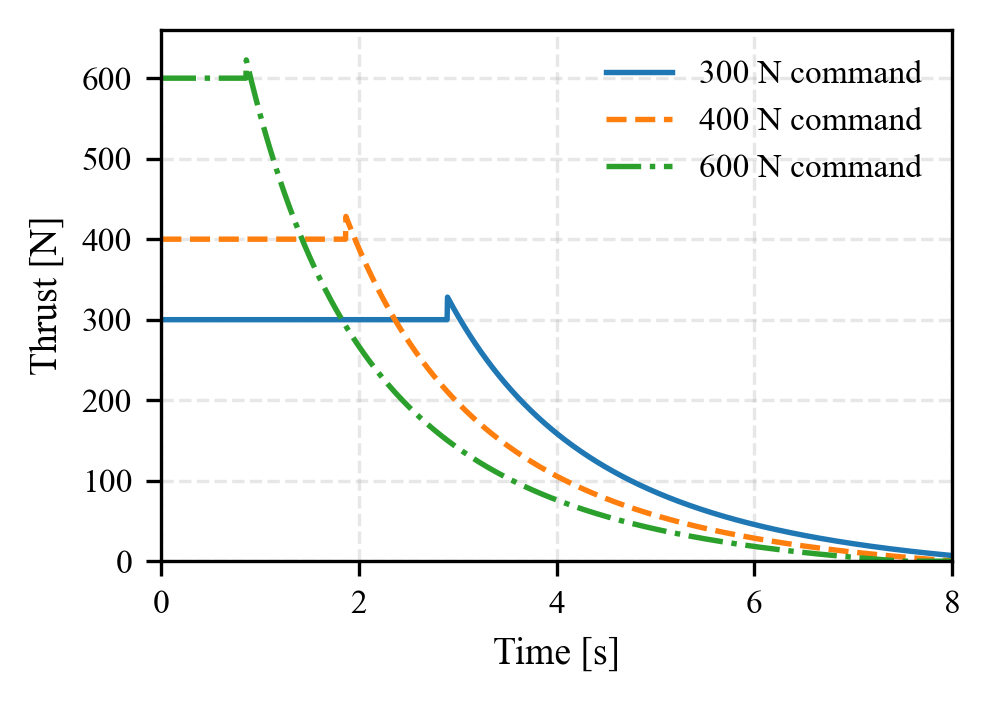 | 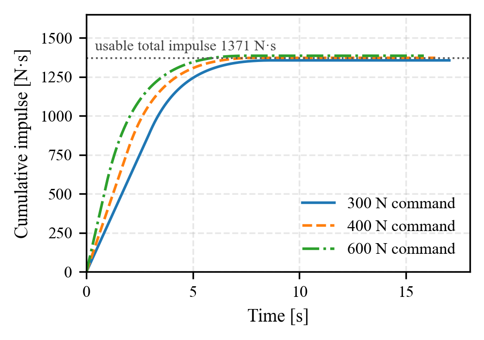 |

At constant commanded thrust the plateau lasts 2.89 s at 300 N, 1.86 s at 400 N and 0.86 s at 600 N. The estimated total impulse is **≈ 1371 N·s**, of which about **950 N·s** is delivered while thrust exceeds the vehicle weight. This makes the impulse budget, not the thrust level, the design driver: a powered descent from 8–10 m fits comfortably, while a sustained hover needs more stored gas.

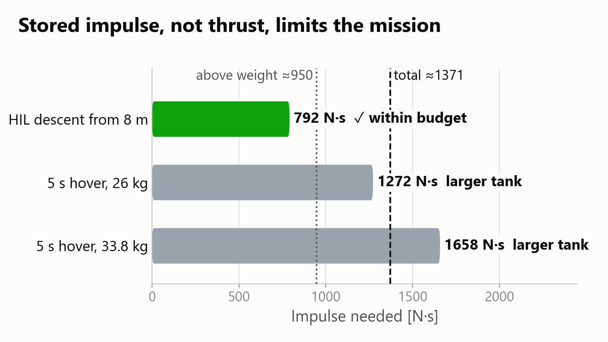

---

## 3. Flight dynamics model

A six-degree-of-freedom model was built in MATLAB/Simulink with Simscape Multibody, treating the vehicle as a rigid body with time-varying mass and inertia.

### Reference frames

The body frame B is fixed at the centre of mass (z up, y forward, x right); the inertial frame I is earth-fixed with z up. Attitude uses the ZYX Euler sequence:

$${}^{I}R_{B}(\psi,\theta,\phi) = R_z(\psi)\,R_y(\theta)\,R_x(\phi) =
\begin{bmatrix}
c_\psi c_\theta & c_\psi s_\theta s_\phi - s_\psi c_\phi & c_\psi s_\theta c_\phi + s_\psi s_\phi\\
s_\psi c_\theta & s_\psi s_\theta s_\phi + c_\psi c_\phi & s_\psi s_\theta c_\phi - c_\psi s_\phi\\
-s_\theta & c_\theta s_\phi & c_\theta c_\phi
\end{bmatrix}, \qquad \mathbf V_I = {}^{I}R_{B}\,\mathbf V_B$$

$$\begin{bmatrix}\dot\phi\\ \dot\theta\\ \dot\psi\end{bmatrix} =
\begin{bmatrix}1 & \sin\phi\tan\theta & \cos\phi\tan\theta\\ 0 & \cos\phi & -\sin\phi\\ 0 & \sin\phi/\cos\theta & \cos\phi/\cos\theta\end{bmatrix}
\begin{bmatrix}p\\ q\\ r\end{bmatrix}$$

| Body axes | TVC force and moment |
|---|---|
| 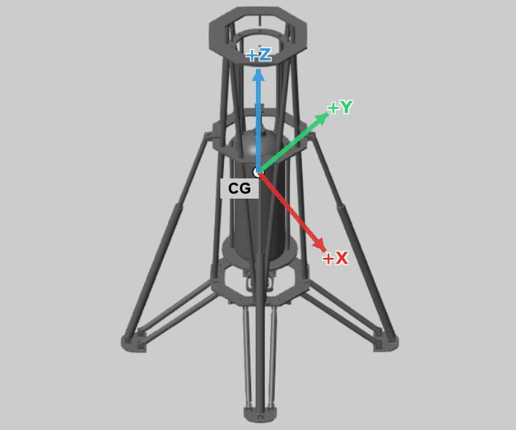 | 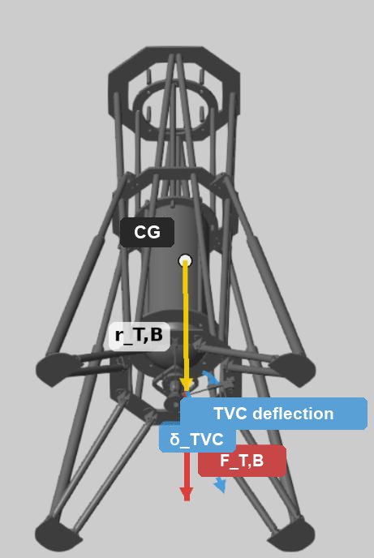 |

### Equations of motion

Translation follows Newton's second law for a variable-mass body and is integrated in the inertial frame; in the body frame it couples with rotation:

$$\mathbf F_I = \frac{d}{dt}\left(m\,\mathbf V_I\right), \qquad \mathbf F_B = m\left(\dot{\mathbf V}_B + \boldsymbol\omega_B \times \mathbf V_B\right)$$

$$m\,\dot{\mathbf v}_I = R\,\mathbf F_{T,B} + \begin{bmatrix}0 & 0 & -mg\end{bmatrix}^T + \mathbf F_{dist}$$

$$\mathbf M_B = I_B\,\dot{\boldsymbol\omega}_B + \boldsymbol\omega_B \times (I_B\,\boldsymbol\omega_B) + \dot I_B\,\boldsymbol\omega_B, \qquad \mathbf M_{T,B} = \mathbf r_{T,B} \times \mathbf F_{T,B}$$

with $\boldsymbol\omega_B = [p\;q\;r]^T$ and the full inertia tensor

$$I_B = \begin{bmatrix} I_{xx} & -I_{xy} & -I_{xz}\\ -I_{yx} & I_{yy} & -I_{yz}\\ -I_{zx} & -I_{zy} & I_{zz}\end{bmatrix}$$

### Variable mass and inertia

The $\dot I_B \boldsymbol\omega_B$ term is kept because gas expenditure changes mass and inertia during the burn. The remaining gas mass is integrated from the commanded mass flow and passed to a Simscape *Variable Cylindrical Solid*:

$$m_{gas}(t) = m_{gas,0} - \int_0^t \dot m\, dt, \qquad m(t) = m_{dry} + m_{gas}(t)$$

The inertia tensor is interpolated between the empty and full states, which also gives its time derivative:

$$I_B(m) = I_{empty} + \frac{m - m_{empty}}{m_{full} - m_{empty}}\left(I_{full} - I_{empty}\right), \qquad \dot I_B = \frac{I_{full} - I_{empty}}{m_{full} - m_{empty}}\;\dot m$$

Gravity, $\mathbf F_g = [0\;0\;-m(t)\,g]^T$, follows the instantaneous mass and acts through the centre of mass, so it creates no moment.

| Gas-mass integrator | Gas mass to the Variable Cylindrical Solid |
|---|---|
| 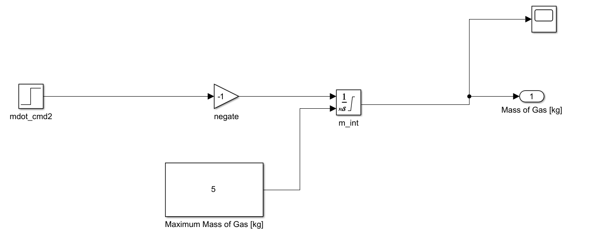 | 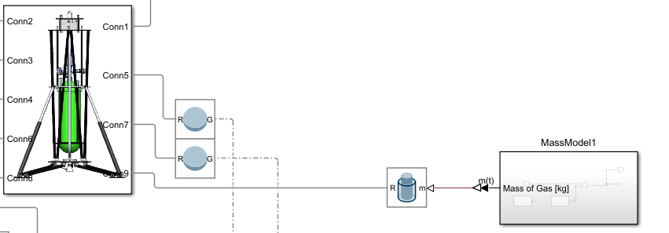 |

### Thrust, TVC and environment

With no nozzle deflection the thrust acts along the body axis, $\mathbf F^{0}_{T,B} = [0\;0\;T]^T$; the two-axis gimbal tilts it to $\mathbf F_{T,B} = [F_{T,x}\;F_{T,y}\;F_{T,z}]^T$, creating the control moment $\mathbf M_{T,B} = \mathbf r_{T,B}\times\mathbf F_{T,B}$. The controller drives two actuator channels, $u_T = T_{cmd}$ and $u_\delta = [\delta_1\;\delta_2]^T$. Attitude is propagated with quaternions, so there is no gimbal-lock singularity. The model includes an ISA atmosphere, an equivalent lateral gust ($F_{dist} = \tfrac12 \rho C_D A V_{rel}^2$, about 5.5 N for a 6 m/s crosswind), a variable gas mass and a per-leg ground-contact model.


| ISA atmosphere | Equivalent wind force | Landing-gear ground contact |
|---|---|---|
| 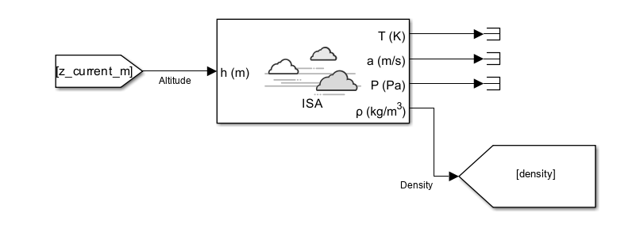 | 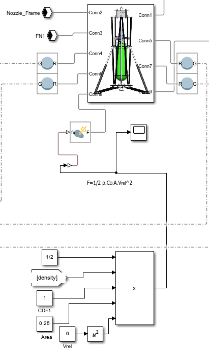 | 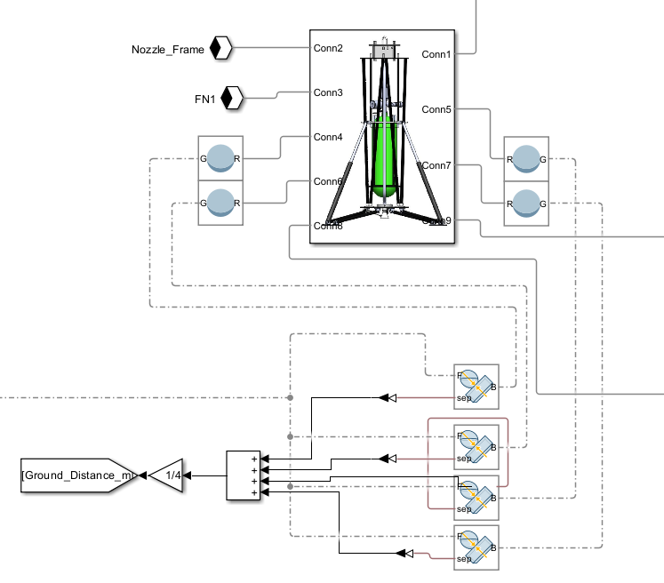 |

---

## 4. Guidance and control


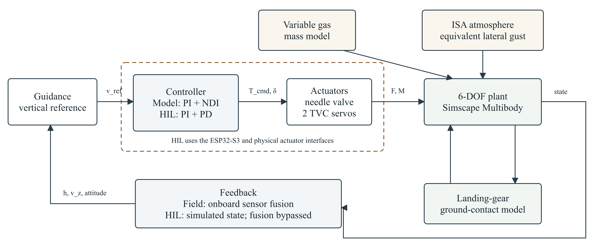

### Vertical channel

A PI law on the vertical-velocity error is built around an explicit gravity feed-forward, and the total thrust is corrected for tilt so that the vertical component is preserved:

$$F_{T,0} = m g, \qquad \Delta F_T = m\left(K_{p,v}\, e_v + K_{i,v}\int e_v\, dt\right), \qquad F_T = \frac{F_{T,0} + \Delta F_T}{\cos\theta\,\cos\phi}$$

The velocity reference is scheduled on altitude: free fall above the 5 m activation altitude, a braking segment below it and a flare to the touchdown speed.

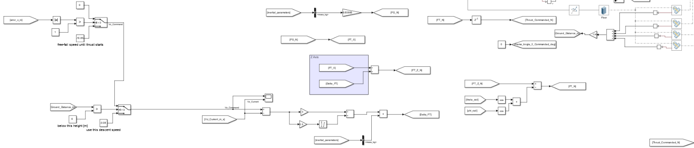

### Attitude channel: nonlinear dynamic inversion

The simulation uses a two-stage cascade (attitude error → rate command → angular-acceleration command), followed by an inversion of the TVC moment relation $M = F_T L \sin\delta$ and an integral corrector:

$$\omega_{cmd} = K_\eta(\eta_{cmd} - \eta), \qquad \alpha_{cmd} = K_\omega(\omega_{cmd} - \omega)$$

$$\delta_{inv} = \arcsin\!\left(\frac{I_B\, \alpha_{cmd}}{F_T\, L}\right), \qquad \delta = -\left(\delta_{inv} + K_I \int (\alpha_{cmd} - \alpha)\, dt\right)$$

Thrust, moment arm and inertia enter the inversion as live signals, so the loop gain adapts as thrust and mass change during the burn. Gains: K<sub>η</sub> = 0.25 s⁻¹, K<sub>ω</sub> = 0.5 s⁻¹, K<sub>I</sub> = 1; vertical channel 12 s⁻¹ / 3 s⁻². The available control moment is about 16 N·m at the ±6° gimbal limit.


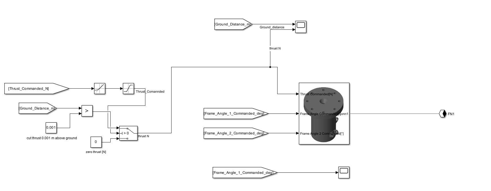

| Rate / acceleration cascade | Vertical channel |
|---|---|
| 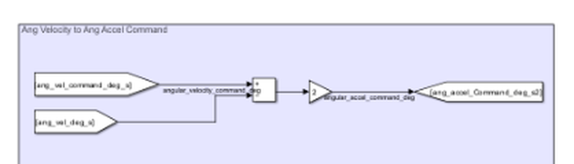 | 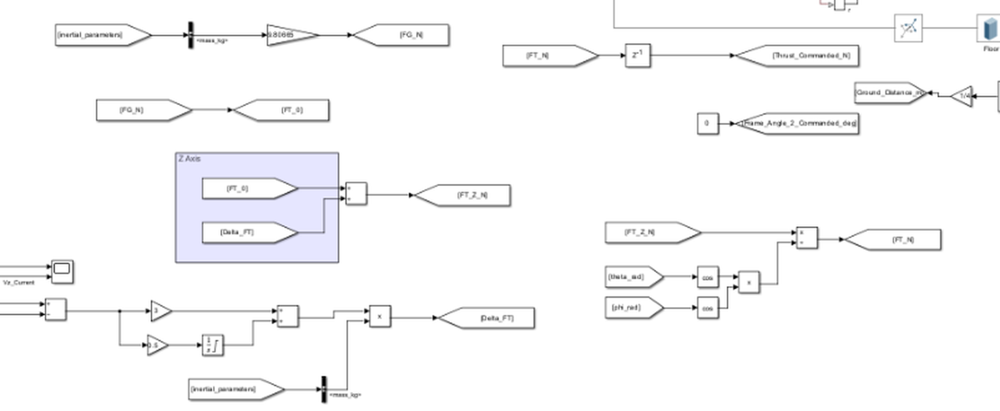 |

### Flight software

On the ESP32-S3 the same structure runs as PID/PD loops at 50 Hz, since the onboard sensors measure neither thrust nor angular acceleration:

| Loop | K<sub>p</sub> / K<sub>i</sub> / K<sub>d</sub> | Integral limit | D-filter α |
|---|---|---|---|
| Vertical velocity | 21 / 15 / 0 | ±0.5 m | 0.20 |
| Pitch | 2 / 0 / 0.5 | — | 0.15 |
| Roll | 1.2 / 0 / 0.2 | — | 0.08 |

---

## 5. Navigation and sensor fusion

A three-state linear Kalman filter fuses barometric altitude, LiDAR range and inertial acceleration, rebuilt every cycle from the measured sample interval:

$$\mathbf x = \begin{bmatrix} z & v_z & b \end{bmatrix}^T, \qquad A = \begin{bmatrix}1 & \Delta t & 0\\ 0 & 1 & -\Delta t\\ 0 & 0 & 1\end{bmatrix}, \qquad B = \begin{bmatrix}\tfrac12\Delta t^2 \\ \Delta t \\ 0\end{bmatrix}, \qquad C = \begin{bmatrix}1 & 0 & 0\\ 1 & 0 & 0\end{bmatrix}$$

The LiDAR range is corrected for tilt, $h_{LiDAR} = d_{raw}\cos\theta_{tilt}$, and its measurement covariance is scheduled (0.001 with a valid return, 999 otherwise), so the filter degrades smoothly to barometer-only operation. Jumps larger than 0.5 m are rejected unless five consecutive samples agree.

| Parameter | Value |
|---|---|
| Process noise Q | diag(0.01, 0.01, 0.001) |
| Barometer / LiDAR noise R | 0.09 / 0.001 (valid) |
| Update rate | 50 Hz, Δt measured each cycle |

On a 1375-sample static bench record the barometer wandered over a 0.49 m band, while the fused estimate tracked the LiDAR to within the logging resolution.

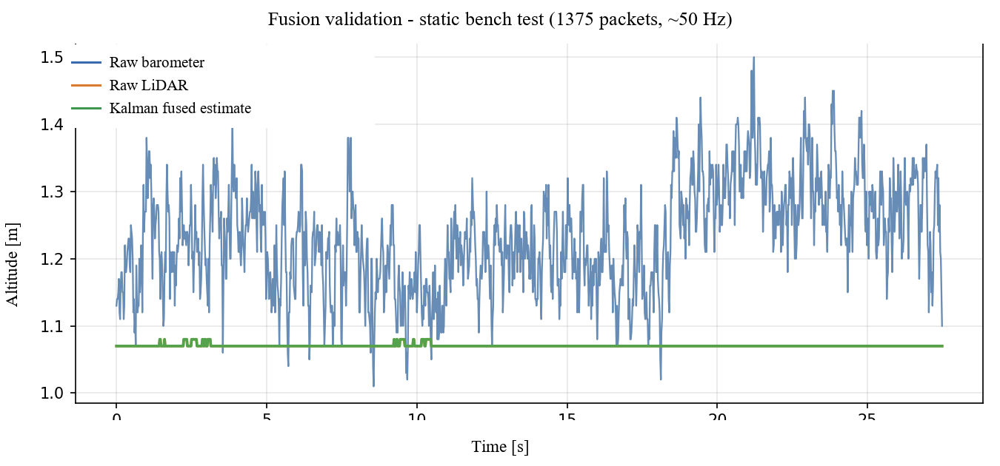

---

## 6. Discretisation and stability

The nonlinear model runs on a fixed 1 ms step (ode4). For linear analysis the controller was discretised with the Tustin transformation at T<sub>s</sub> = 10 ms,

$$s = \frac{2}{T_s}\,\frac{z-1}{z+1}$$

and a 0.1–30 Hz chirp gave matching responses for the continuous and discrete designs.

| Loop | Gain margin | Phase margin | Bandwidth |
|---|---|---|---|
| X attitude | 9.2 dB | 47.8° | 12.5 rad/s |
| Y attitude | 8.9 dB | 46.5° | 12.1 rad/s |
| Z altitude | 11.4 dB | 58.2° | 2.4 rad/s |

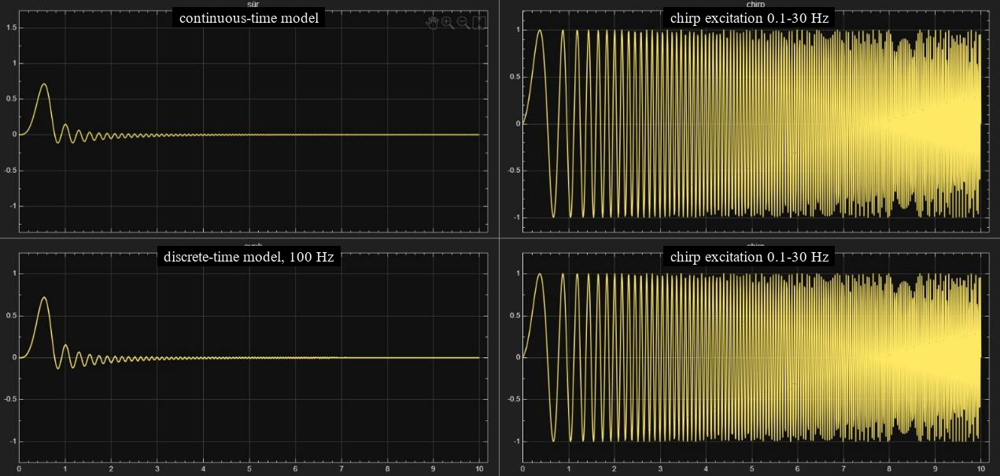

---

## 7. Simulation results

Nominal and disturbed (15° initial tilt plus a 6 m/s lateral gust) soft-landing and ascent-and-hover scenarios were simulated from 8–10 m. The nominal landing touches down at 0.1–0.2 m/s, and in both hover cases the vehicle reaches and holds 5 m.

---

## 8. Hardware-in-the-loop testing

The real flight computer, both TVC servos and the valve drive ran in lock-step with the simulated vehicle:

| Parameter | Value |
|---|---|
| Physics step / exchange rate | 1 ms / 50 Hz, UART 115200 baud |
| Controller latency | 20–27 ms |
| Packet loss | 0.6–3.9 % |
| Plant mass | 33.8 kg (17 % above the wet mass, for margin) |

- **Landing run from 8 m.** Thrust started 0.04 s after crossing 5 m and reached the 600 N limit 0.06 s later. The descent was arrested 0.13 m above the ground, and touchdown stayed within the landing-gear limit.
- **Hover run.** Over 25.4 s the mean thrust stayed within 0.1 % of the equilibrium value, and body tilt stayed at about 0.006°, confirming the gravity feed-forward.
- **Integration issues caught before flight.** HIL caught and closed five issues that a plant-only simulation cannot show: a watchdog reset from a task loop without a yield, a missing gravity feed-forward, velocity gains that differed from the model, a duplicated ESP-NOW MAC address, and a stability limit at 120 ms control latency. With 20–27 ms measured latency, the implementation has about a factor of five of margin.


---

## 9. Ground and field tests

- **Leak test.** The assembled pneumatic system held 180 bar for one hour with less than 5 % pressure loss in all five repetitions.
- **Nozzle firing.** Five single-nozzle firings at about 152 bar all established flow and thrust.
- **Structural drop test.** Two drops from 0.4 m, one as a bare chassis and one fully integrated, showed no cracking, distortion or loosening.
- **Field campaign.** A tethered drop from 9.9 m and the untethered competition flight produced onboard flight logs ([data/flight](data/flight)). Their analysis defines the next development steps: faster altitude estimation during a fast descent, an end-to-end thrust-onset test, load-cell thrust measurement and a staged powered-flight campaign.

For a descent with thrust withheld above the activation altitude $z_a$, the minimum constant thrust that stops the vehicle at the ground after a thrust-onset delay τ is

$$T_{req} = m\left(g + \frac{v_o^2}{2 h_o}\right), \qquad v_o = v_a + g\tau, \qquad h_o = z_a - v_a\tau - \tfrac12 g\tau^2, \qquad v_a = \sqrt{2g(h_r - z_a)}$$

This relation sizes the thrust-onset latency budget for the landing profile.

---

## 10. Simulink model gallery

Subsystems of the 6-DOF flight simulation (MATLAB/Simulink, Simscape Multibody):


| Control loop | Vertical velocity control |
|---|---|
|  |  |
| **Dynamic inversion attitude control** | **Controller and actuator** |
|  |  |
| **Variable gas mass** | **Variable Cylindrical Solid** |
|  |  |
| **ISA atmosphere** | **Equivalent wind force** |
|  |  |
| **Landing-gear ground contact** | **TVC force and moment** |
|  |  |

**Hardware-in-the-loop model** (`simulation/hil_plant`): serial packet exchange with the flight computer, actuator dynamics and the vehicle plant.


Full-model diagrams exported directly from the `.slx` files are in [`figures/simulink_models`](figures/simulink_models).

---

## Repository layout

```
simulation/
  ndi_6dof/        6-DOF Simulink/Simscape model with nonlinear dynamic inversion (NDI)
  ktr_6dof/        6-DOF flight simulation from the critical design review
  hil_plant/       Vehicle model and loop architecture for hardware-in-the-loop testing
hil/               MATLAB HIL runner and plotting scripts, run summaries and plots (landing, hover)
firmware/          ESP32-S3 flight software with HIL mode (landing and hover builds, earlier v30)
data/
  flight/          Onboard flight logs from the field campaign
  hil/             HIL landing and hover runs
  propulsion/      Real-gas blowdown thrust-time tables (300/400/600 N)
  bom/             Bill of materials with supplier links
analysis/          Python scripts that produce the figures from the data
figures/
  paper/           Paper figures
  simulation_model/ Simulink/Simscape subsystems of the flight simulation
  simulink_models/ Diagrams exported from the Simulink models
  simulink/        Simulation result plots and Simulink screenshots
  hardware/        Vehicle photos, avionics board and CAD renders
poster/            iPoster graphics, short test clips and the scripts that made them
docs/              Architecture diagram
```

## Running

Python 3.10+ with `numpy`, `matplotlib` and `openpyxl`:

```bash
cd analysis
python sekil_uret.py            # thrust, impulse and nozzle figures
python itki_gecikme_butcesi.py  # thrust-onset budget
cd ../poster/scripts
python uret_grafikler.py        # poster graphics
```

The Simulink models need MATLAB/Simulink with Simscape Multibody (R2024a or later). The firmware targets the ESP32-S3 with the Arduino core; set `SLAVE_MAC` to your own ground-station address before building. Most code comments and some file names are in Turkish.

The paper itself (copyright © IAF), the competition design reports, the CAD source files and the raw test videos are not included.

## Team

S-TEK Vertical Landing Rocket Team, Erciyes University: Hasan Baran Gurbuz, Osman Melih Eroglu, Ayse Sila Dogan, Berkay Polat, Baris Feytek, Sami Pekdemir, Serhat Seren, Arda Kaan Ergul, Murat Atici, Asya Demir.

Supported by TÜBİTAK SAGE, TEKNOFEST and Erciyes University.

## Citation

```
H.B. Gurbuz et al., Low-Cost Prototyping of Reusable Launch Systems: Design and Flight Testing of a
Cold-Gas Vertical Landing Rocket, 77th International Astronautical Congress (IAC 2026), Antalya,
Türkiye, 5–9 October 2026, IAC-26-E2.IPB.14.x114159.
```

## License

© 2026 the authors. All rights reserved. Please get in touch before reusing the code, data or media.
